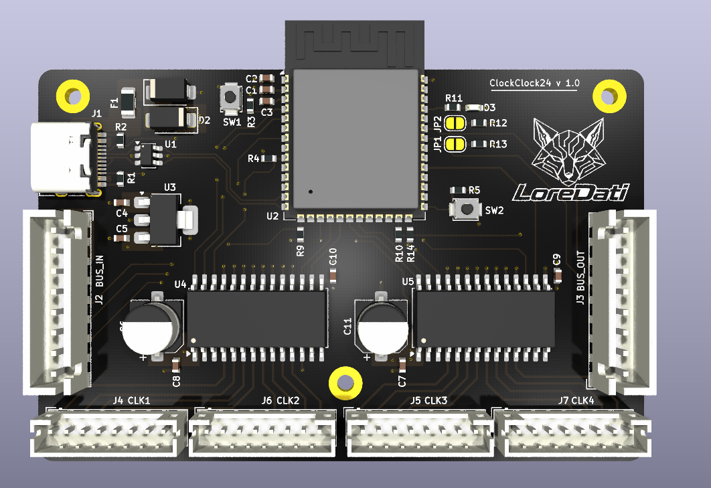
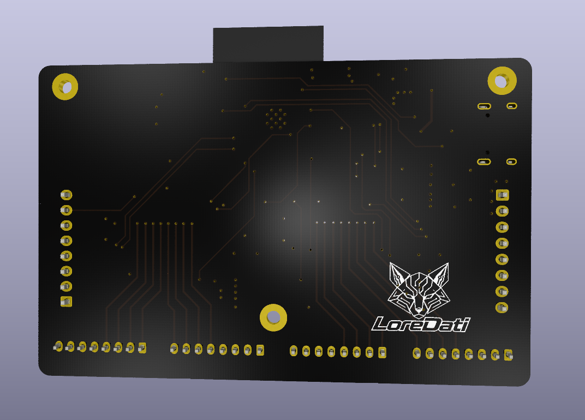
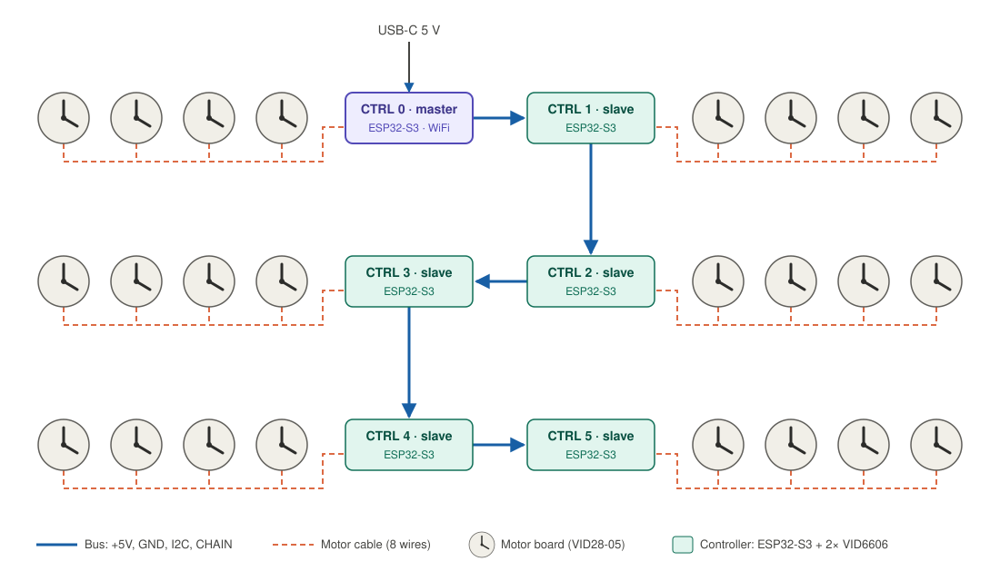
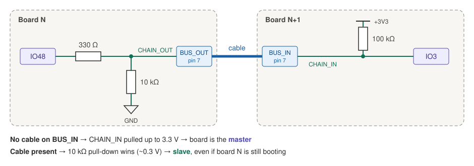

# ClockClock 24 – Replica v2

A personal re-implementation of the **ClockClock 24** kinetic sculpture by [Humans Since 1982](https://www.humanssince1982.com/): 24 analog clocks in a 3 × 8 grid whose hands move together to show the time in digital form.

Inspired by [Vallasc/clockclock24-replica](https://github.com/Vallasc/clockclock24-replica), with a redesigned architecture: ESP32-S3 controllers, USB-C on every board, an auto-addressed I2C bus and separate motor boards.

> For personal, non-commercial use only. All design rights belong to Humans Since 1982.

  
  

<em>Controller board, rev A (3D render, top and bottom)</em>

## Architecture

**6 identical controller boards** (2 per row), each driving **4 clocks (8 motors)** via cables to **24 passive motor boards**, one behind each clock.

- Same hardware and firmware on every controller.
- The **first board in the chain** becomes the **master**: WiFi, NTP, web interface, and it sends target positions to the others over I2C.
- Each controller generates step pulses for its own motors, so only short, slow messages travel on the bus.

### Controller board – rev A (layout in review)

USB-C (5 V, programming + debug via native USB) → protection → +5 V rail → 2× VID6606 drivers and the bus; AP7361C LDO → 3.3 V for the ESP32-S3-WROOM-1-N8.

### Motor board – in development

A minimal board with only the motor and its connector: one VID28-05 / BKA30D-R5 dual-shaft stepper (two motors, coaxial shafts, one hand each) and one 8-pin connector. No active parts.

Public documentation on this motor is scarce (mechanical drawings, pin numbering and the 360° no-stop variant all differ between sellers), so the footprint and pinout are being validated on real samples before the board is finalized.

## Bus and master detection

The bus connectors carry `+5V`, `GND`, `I2C_SDA` (IO41), `I2C_SCL` (IO42) and a `CHAIN` line.

- Nothing on `BUS_IN` → `CHAIN_IN` high → **master**. Cable present → low → **slave**, even if the upstream board is still booting.
- At startup the master passes a "token" down the chain via `CHAIN_OUT`. Each board answers on a temporary I2C address and receives its permanent one, so addresses match the physical order automatically.
- I2C pull-ups (4.7 kΩ) are on every board but enabled only via solder jumpers **JP1 / JP2: close them on the master only**.

## Connectors

**Bus – `BUS_IN` / `BUS_OUT`** (JST-XH 8 pin, straight cables)

| 1 | 2 | 3 | 4 | 5 | 6 | 7 | 8 |
|---|---|---|---|---|---|---|---|
| +5V | +5V | GND | GND | SDA | SCL | CHAIN_IN / OUT | GND |

**Motors – `CLK1`…`CLK4`** (JST-PH 8 pin): pins 1–4 = first motor (`OUT1–4`), pins 5–8 = second motor. Same pinout on every connector and motor board, so all cables and motor boards are interchangeable. Using different connector families for bus and motors makes it impossible to plug a bus cable into a motor output.

## Good to know

- **Motors**: use the **360° version without end stops** of the VID28-05 / BKA30D-R5. It's hard to find, so order samples first.
- **Resolution**: 1/12° per step → 4320 steps per revolution, max ~7.2 kHz step rate (600°/s).
- **No position sensors**: hand positions are saved in flash after every move. A "moving" flag detects power loss mid-movement, and calibration (±1 step per hand) is done from the web interface.
- **Backlash** (~0.5–1°): always do the final approach from the same direction.
- **Idle coils off**: `VID_RST` is pulled low after each move. The 180:1 gearbox holds the hands, which saves power and heat.
- **Power**: realistically < 2 A for the whole clock with all hands moving. Any board can be the 5 V entry point (USB-C max 3 A).
- **VID6606 logic level**: VIH min is 3.15 V at 5 V supply, so 3.3 V from the ESP32 works but with little margin. Not available at LCSC: hand-solder (SOP-28).
- **PCB**: 4 layers (signals / GND / +5V / signals), KiCad 10. The ESP32-S3 library footprint's keep-out can trigger false DRC errors in KiCad 10: replace it with a board-level rule area.
- **Firmware**: PlatformIO, `-DARDUINO_USB_CDC_ON_BOOT=1` (TXD0 is used for the status LED).

## Credits

- Original design: [Humans Since 1982](https://www.humanssince1982.com/)
- Reference replica: [Vallasc/clockclock24-replica](https://github.com/Vallasc/clockclock24-replica)
- Hardware v2: Lorenzo Dati
